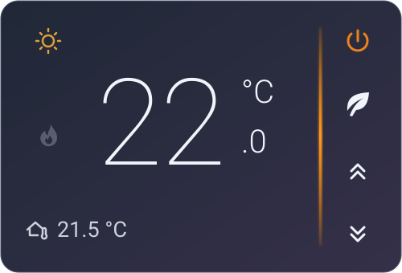
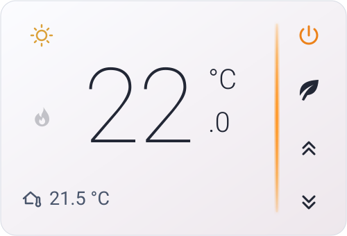

# heating-card
A Home Assistant thermostat card with oversized temperatures and an amber accent.
# Heating Card

[](https://hacs.dev/docs/faq/custom_repositories/)
[](https://github.com/szbence7/heating-card/releases)
<a href="https://www.buymeacoffee.com/benceix"></a>

Heating Card gives your Home Assistant thermostat an oversized target temperature, a room temperature readout and a slim amber divider. It follows your dashboard’s light or dark theme.

| Dark mode | Light mode |
| --- | --- |
|  |  |

## Installation

1. In Home Assistant, open **HACS**. From the three-dot menu, choose **Custom repositories**.
2. Enter `https://github.com/szbence7/heating-card` and select **Dashboard**.
3. Open **Heating Card**, choose **Download** and refresh your browser.
4. Edit your dashboard, choose **Add card**, then choose **Heating Card**. Open the code editor and configure your entities using the example below.

If you manage dashboard resources in YAML, add the downloaded file as a JavaScript module under your existing resources list.

# Heating Card

[](https://hacs.dev/docs/faq/custom_repositories/)
[](https://github.com/szbence7/heating-card/releases)
<a href="https://www.buymeacoffee.com/benceix"></a>

Heating Card gives your Home Assistant thermostat an oversized target temperature, a room temperature readout and a slim amber divider. It follows your dashboard’s light or dark theme.

| Dark mode | Light mode |
| --- | --- |
|  |  |

## Installation

1. In Home Assistant, open **HACS**. From the three-dot menu, choose **Custom repositories**.
2. Enter `https://github.com/szbence7/heating-card` and select **Dashboard**.
3. Open **Heating Card**, choose **Download** and refresh your browser.
4. Edit your dashboard, choose **Add card**, then choose **Heating Card**. Open the code editor and configure your entities using the example below.

If you manage dashboard resources in YAML, add the downloaded file as a JavaScript module under your existing resources list.

```yaml
- url: /hacsfiles/heating-card/heating-card.js
  type: module
```

## Configuration

```yaml
type: custom:heating-card
entity: climate.living_room
weather_entity: weather.home
controls: false
```

| Option | Default | Description |
| --- | --- | --- |
| `entity` | Required | A thermostat entity with a single target temperature. |
| `weather_entity` | Optional | A weather entity for the weather icon. The card uses a partly cloudy icon by default. |
| `controls` | `false` | Enables supported controls on the right. |

The power button switches between Heat and Off when the thermostat offers both modes. The leaf toggles Eco when the thermostat offers the Eco and None presets. The chevrons use the thermostat’s advertised step and limits. The display uses Home Assistant’s configured temperature unit and locale.

## What’s new

See the [changelog](CHANGELOG.md) and [GitHub releases](https://github.com/szbence7/heating-card/releases).
```yam
- url: /hacsfiles/heating-card/heating-card.js
  type: module
```

## Configuration

```yaml
type: custom:heating-card
entity: climate.living_room
weather_entity: weather.home
controls: false
```

| Option | Default | Description |
| --- | --- | --- |
| `entity` | Required | A thermostat entity with a single target temperature. |
| `weather_entity` | Optional | A weather entity for the weather icon. The card uses a partly cloudy icon by default. |
| `controls` | `false` | Enables supported controls on the right. |

The power button switches between Heat and Off when the thermostat offers both modes. The leaf toggles Eco when the thermostat offers the Eco and None presets. The chevrons use the thermostat’s advertised step and limits. The display uses Home Assistant’s configured temperature unit and locale.

## What’s new

See the [changelog](CHANGELOG.md) and [GitHub releases](https://github.com/szbence7/heating-card/releases).
